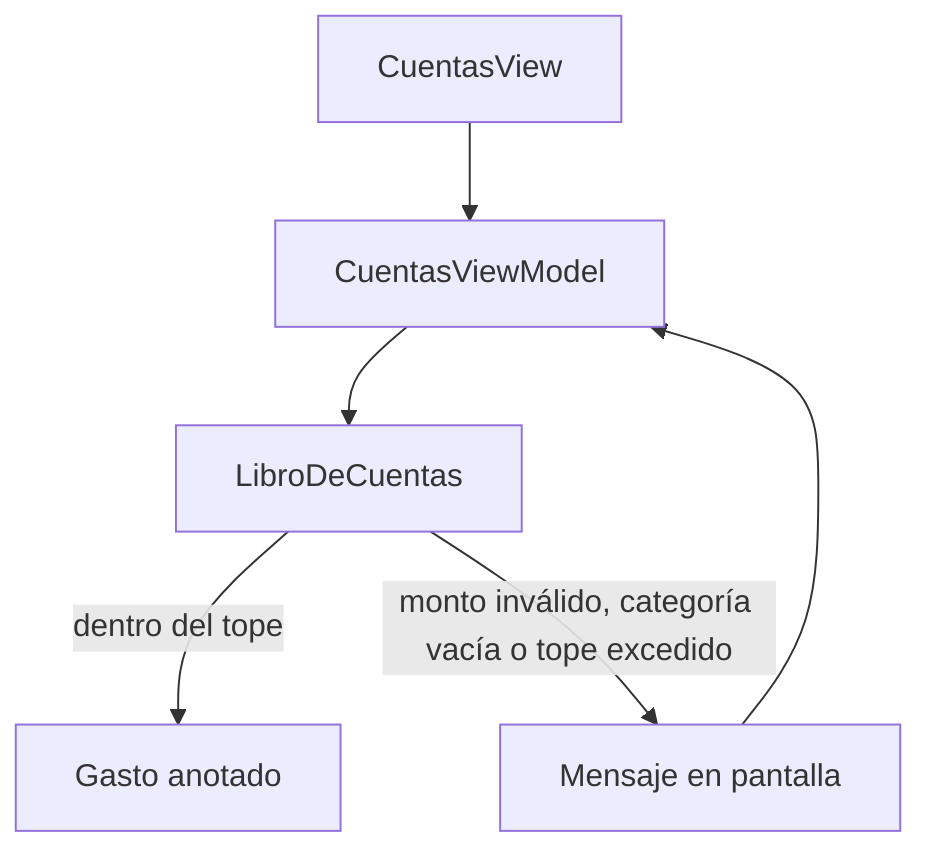

# Cuentas claras

Un cuaderno de gastos del mes. Anotas un monto y una categoría; si la suma pasa el tope, el gasto no entra.

## Concepto

El libro de cuentas guarda montos en céntimos y conoce el tope mensual. La pantalla no decide la regla: le pregunta al libro y muestra la frase que devuelve el view model. Así se puede probar el tope en Linux, sin un iPhone.

## Stack

| Pieza | Para qué |
| --- | --- |
| Swift 6 | Dominio y view model, con Swift Package Manager. |
| Clean Architecture | `CuentasDomain` no importa SwiftUI. |
| MVVM | `CuentasViewModel` traduce `ErrorLibro` a un mensaje. |
| SwiftUI | `CuentasView`, compilada solo con `#if canImport(SwiftUI)`. |
| XCTest | `swift test` cubre el tope y el monto inválido. |

## Flujo



## Correr

Desde esta carpeta:

```bash
swift test
```

La vista se abre en Xcode, donde existe SwiftUI.
